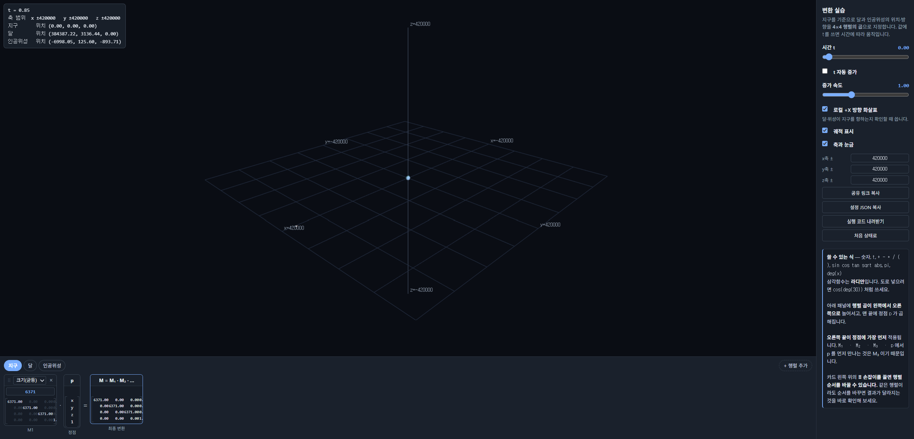
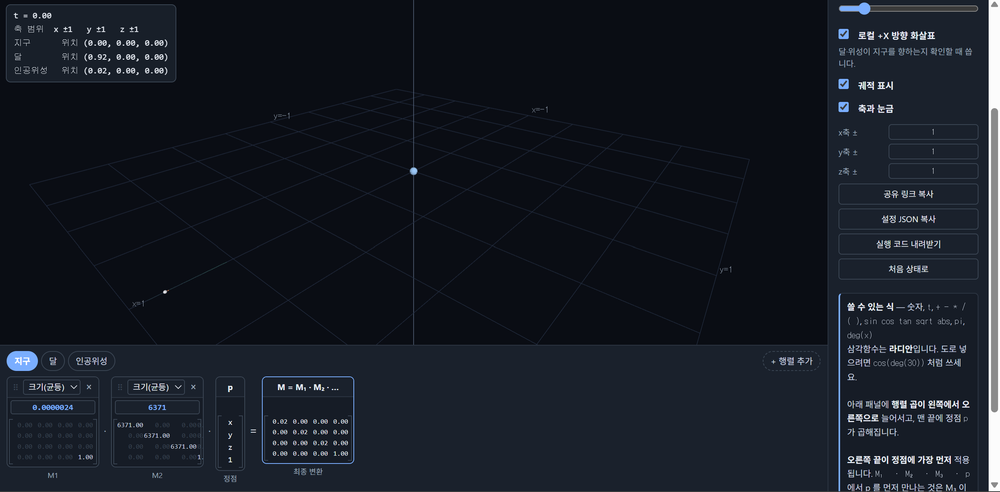
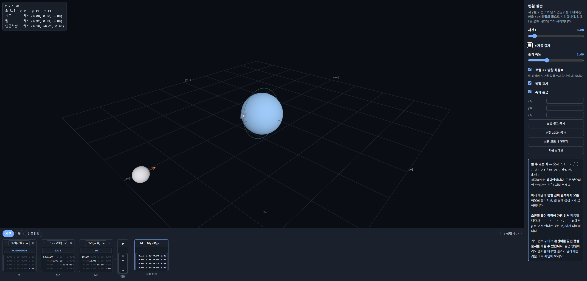

# 2주차 — 지구 · 달 · 인공위성의 변환 설계

- 이름: 김규완
- 저장소: https://github.com/kyuwan-kim/cg-2026-solar

- 실행: [Task 1](task1.html) · [Task 2](task2.html) · [Task 3](task3.html)

## Task 1 — 실제 비율로 배치하기

### 조사한 값

| 항목 | 값 | 출처 |
| --- | --- | --- |
| 지구 반지름 | 6371 km | 위키백과 |
| 달 반지름 | 1737 km | 위키백과 |
| 달까지 거리 | 384400 km | 위키백과 |
| 달 공전 속도 | 1.022 km/s | 위키백과 |
| 위성 크기(아리랑 3호) | 2m * 3.2m | 위키백과 |
| 위성(아리랑 3호) 고도 | 685 km | satellitemap.space |
| 위성(아리랑 3호) 공전 속도 | 7.4 km/s | satellitemap.space |
| 위성(아리랑 3호) 궤도 경사각 | 98도 | satellitemap.space |

### 단위를 정한 방법

크기는 `km`단위, 시간은 `h`(1시간)단위로 선정하였습니다. 실제비율로 배치하고 표기하고는데 있어 사람이 알아보기 가장 적합한 단위로 느껴졌기 때문입니다.

### 내가 넣은 변환

```json
{
  "range": {
    "x": "420000",
    "y": "420000",
    "z": "420000"
  },
  "objects": [
    {
      "id": "earth",
      "name": "지구",
      "color": [
        0.35,
        0.6,
        0.95
      ],
      "steps": [
        {
          "type": "Su",
          "args": [
            "6371"
          ]
        }
      ]
    },
    {
      "id": "moon",
      "name": "달",
      "color": [
        0.78,
        0.78,
        0.82
      ],
      "steps": [
        {
          "type": "Rz",
          "args": [
            "0.55*t"
          ]
        },
        {
          "type": "T",
          "args": [
            "384400",
            "0",
            "0"
          ]
        },
        {
          "type": "Su",
          "args": [
            "1737"
          ]
        },
        {
          "type": "Rz",
          "args": [
            "180"
          ]
        }
      ]
    },
    {
      "id": "sat",
      "name": "인공위성",
      "color": [
        0.95,
        0.72,
        0.35
      ],
      "steps": [
        {
          "type": "Rx",
          "args": [
            "98"
          ]
        },
        {
          "type": "Rz",
          "args": [
            "220.41*t"
          ]
        },
        {
          "type": "T",
          "args": [
            "7056",
            "0",
            "0"
          ]
        },
        {
          "type": "Su",
          "args": [
            "0.0026"
          ]
        },
        {
          "type": "Ry",
          "args": [
            "180"
          ]
        }
      ]
    }
  ]
}
```

### 변환값 이유

- **축 범위**

실제 거리를 이용할 시 지구에서 가장 먼 달까지 화면 내에 포함하기 위해, 달까지의 거리보다 조금 큰 `420000`으로 변경했습니다.

- **지구**

조사한 실제 지구의 값을 반영하여 `Su`는 `6371`로 설정하였습니다.

- **달**

조사한 실제 달의 값을 반영하여 `Rz` (달의 공전 값)을 `0.55*t` (시간당 회전각)로,`T` (달까지 거리)를 `384400`으로, `Su` (달의 크기)를 `1737`으로, 마지막으로 달이 지구를 바라보도록 `Rz`를 `180`으로 순차적으로 추가했습니다.

해당 순서로 값을 배치한 이유는 계산이 오른쪽부터 적용되므로, 먼저 달이 바라보는 방향과 크기를 `Rz`와 `Su`로 조정 한 후, 궤도에 맞게 `T`로 이동시킨 뒤  `Rz`를 이용하여, 원점기준으로 전체를 회전시켜 공전 값을 주기 위해서 입니다.

- **위성**

조사한 실제 위성의 값을 반영하여 `Rx` (궤도 경사각)을 `98`으로, `Rz` (위성의 공전 값)을 `220.41*t`(시간당 회전각)로, `T` (고도)를 `7056`으로, `Su` (위성의 크기)를 `0.0026`으로, 마지막으로 위성이 지구를 바라보도록 `Rz`를 `180`으로 순차적으로 추가했습니다.

해당 순서로 값을 배치한 이유는 계산이 오른쪽부터 적용되므로, 먼저 위성이 바라보는 방향과 크기를 `Rz`와 `Su`로 조정 한 후, 고도에 맞게 `T`로 이동시킨 뒤, `Rz`를 이용하여 원점기준으로 전체를 회전시켜 공전값을 준 뒤, `Rx`를 이용하여 전체 궤도를 회전시켜, 궤도 경사각을 반영하기 위해서 입니다.

### 숫자가 커서 생긴 문제
  
지구와 달의 거리가 멀어 한눈들어오지 않았고, 위성의 크기가 너무 작아 잘 보이지 않았습니다.

### 달과 위성이 지구 향하게한 방법

기본 값이 바깥을 향하도록 되어있었으므로, `Rz`로 `180` 회전값을 주어 지구를 바라보도록 하였습니다.

- task1 결과 캡쳐



- 공유 링크: [task 1 결과](https://cg.catholic.ac.kr/~mgchoi/CG/demos/d02-transform-lab.html?d=eyJyYW5nZSI6eyJ4IjoiNDIwMDAwIiwieSI6IjQyMDAwMCIsInoiOiI0MjAwMDAifSwib2JqZWN0cyI6W3siaWQiOiJlYXJ0aCIsIm5hbWUiOiLsp4DqtawiLCJjb2xvciI6WzAuMzUsMC42LDAuOTVdLCJzdGVwcyI6W3sidHlwZSI6IlN1IiwiYXJncyI6WyI2MzcxIl19XX0seyJpZCI6Im1vb24iLCJuYW1lIjoi64usIiwiY29sb3IiOlswLjc4LDAuNzgsMC44Ml0sInN0ZXBzIjpbeyJ0eXBlIjoiUnoiLCJhcmdzIjpbIjAuNTUqdCJdfSx7InR5cGUiOiJUIiwiYXJncyI6WyIzODQ0MDAiLCIwIiwiMCJdfSx7InR5cGUiOiJTdSIsImFyZ3MiOlsiMTczNyJdfSx7InR5cGUiOiJSeiIsImFyZ3MiOlsiMTgwIl19XX0seyJpZCI6InNhdCIsIm5hbWUiOiLsnbjqs7XsnITshLEiLCJjb2xvciI6WzAuOTUsMC43MiwwLjM1XSwic3RlcHMiOlt7InR5cGUiOiJSeCIsImFyZ3MiOlsiOTgiXX0seyJ0eXBlIjoiUnoiLCJhcmdzIjpbIjIyMC40MSp0Il19LHsidHlwZSI6IlQiLCJhcmdzIjpbIjcwNTYiLCIwIiwiMCJdfSx7InR5cGUiOiJTdSIsImFyZ3MiOlsiMC4wMDI2Il19LHsidHlwZSI6IlJ5IiwiYXJncyI6WyIxODAiXX1dfV19)

## Task 2 — NDC 범위에 맞추기

### 내가 넣은 변환

```json
{
  "range": {
    "x": "1",
    "y": "1",
    "z": "1"
  },
  "objects": [
    {
      "id": "earth",
      "name": "지구",
      "color": [
        0.35,
        0.6,
        0.95
      ],
      "steps": [
        {
          "type": "Su",
          "args": [
            "0.0000024"
          ]
        },
        {
          "type": "Su",
          "args": [
            "6371"
          ]
        }
      ]
    },
    {
      "id": "moon",
      "name": "달",
      "color": [
        0.78,
        0.78,
        0.82
      ],
      "steps": [
        {
          "type": "Su",
          "args": [
            "0.0000024"
          ]
        },
        {
          "type": "Rz",
          "args": [
            "0.55*t"
          ]
        },
        {
          "type": "T",
          "args": [
            "384400",
            "0",
            "0"
          ]
        },
        {
          "type": "Su",
          "args": [
            "1737"
          ]
        },
        {
          "type": "Rz",
          "args": [
            "180"
          ]
        }
      ]
    },
    {
      "id": "sat",
      "name": "인공위성",
      "color": [
        0.95,
        0.72,
        0.35
      ],
      "steps": [
        {
          "type": "Su",
          "args": [
            "0.0000024"
          ]
        },
        {
          "type": "Rx",
          "args": [
            "98"
          ]
        },
        {
          "type": "Rz",
          "args": [
            "220.41*t"
          ]
        },
        {
          "type": "T",
          "args": [
            "7056",
            "0",
            "0"
          ]
        },
        {
          "type": "Su",
          "args": [
            "0.0026"
          ]
        },
        {
          "type": "Ry",
          "args": [
            "180"
          ]
        }
      ]
    }
  ]
}
```

### 변환값 이유

- **축 범위**

NDC 범위에 맞추기위해 축 범위 값을 모두 `1`로 조정하였습니다.

- **지구**

비율은 유지한 채 크기만 줄이기 위에 가장 앞에 `Su`값을 `0.0000024`를 주어 크기를 줄였습니다.

- **달**

비율은 유지한 채 크기만 줄이기 위에 가장 앞에 `Su`값을 `0.0000024`를 주어 크기를 줄였습니다.

- **위성**

비율은 유지한 채 크기만 줄이기 위에 가장 앞에 `Su`값을 `0.0000024`를 주어 크기를 줄였습니다.

### `Su`값 선정 과정

가장 멀리 있는 물체가 −1 ~ 1 안에 들어와야 하므로,

384400 (달까지 거리) + 1737 (달 반지름) = 386137

1/386137 = 0.00000258975 이므로,

여유값을 주어 `0.0000024`로 선정했습니다.

### 맨 앞에 넣은 이유

맨 앞의 배율은 마지막에 적용되므로, 물체의 크기 뿐만 아니라 위치까지 줄여줍니다. 이로 인해 이것이 "장면 전체를 줄일 수 있게 됩니다.

만약 맨 뒤에 넣게 된다면 위치는 그대로 멀리 위치하며 각 지구, 달, 위성의 크기만 작아져 실제 비율과도 달라지고 달이 화면에 보이지 않게 될 것 입니다.

### 세 물체에 같은 배율을 쓴 이유

실제 비율을 유지한 채 크기를 줄이는 것이 목적이므로 물체간의 비율을 맞추기 위해서 같은 배율을 사용해야합니다.

### 비율을 유지한 결과

비율을 유지한 결과, 화면에서 지구는 작게나마 보이지만 인공위성은 거의 보이지 않는 모습입니다.


### 장단점

장점으로는 실제 비율을 유지하며 화면 안에 세 물체를 모두 넣을 수 있으나,

단점으로는 아직 세 물체의 크기나 거리가 극단적이기에 한눈에 알아보기 힘들다는 문제가 해결되지 않았습니다.

- task2 결과 캡쳐



- 공유 링크: [task2결과](https://cg.catholic.ac.kr/~mgchoi/CG/demos/d02-transform-lab.html?d=eyJyYW5nZSI6eyJ4IjoiMSIsInkiOiIxIiwieiI6IjEifSwib2JqZWN0cyI6W3siaWQiOiJlYXJ0aCIsIm5hbWUiOiLsp4DqtawiLCJjb2xvciI6WzAuMzUsMC42LDAuOTVdLCJzdGVwcyI6W3sidHlwZSI6IlN1IiwiYXJncyI6WyIwLjAwMDAwMjQiXX0seyJ0eXBlIjoiU3UiLCJhcmdzIjpbIjYzNzEiXX1dfSx7ImlkIjoibW9vbiIsIm5hbWUiOiLri6wiLCJjb2xvciI6WzAuNzgsMC43OCwwLjgyXSwic3RlcHMiOlt7InR5cGUiOiJTdSIsImFyZ3MiOlsiMC4wMDAwMDI0Il19LHsidHlwZSI6IlJ6IiwiYXJncyI6WyIwLjU1KnQiXX0seyJ0eXBlIjoiVCIsImFyZ3MiOlsiMzg0NDAwIiwiMCIsIjAiXX0seyJ0eXBlIjoiU3UiLCJhcmdzIjpbIjE3MzciXX0seyJ0eXBlIjoiUnoiLCJhcmdzIjpbIjE4MCJdfV19LHsiaWQiOiJzYXQiLCJuYW1lIjoi7J246rO17JyE7ISxIiwiY29sb3IiOlswLjk1LDAuNzIsMC4zNV0sInN0ZXBzIjpbeyJ0eXBlIjoiU3UiLCJhcmdzIjpbIjAuMDAwMDAyNCJdfSx7InR5cGUiOiJSeCIsImFyZ3MiOlsiOTgiXX0seyJ0eXBlIjoiUnoiLCJhcmdzIjpbIjIyMC40MSp0Il19LHsidHlwZSI6IlQiLCJhcmdzIjpbIjcwNTYiLCIwIiwiMCJdfSx7InR5cGUiOiJTdSIsImFyZ3MiOlsiMC4wMDI2Il19LHsidHlwZSI6IlJ5IiwiYXJncyI6WyIxODAiXX1dfV19)

## Task 3 — 더 나은 표현 제안

### 실제 비율은 정보전달하기 적합한가

실제 비율의 경우세 물체의 크기나 거리가 극단적이기에 한눈에 알아보기 힘들어 정보전달에 적합하지 않았습니다.

### 더 나은 표현 방법

달과 위성의 크기를 과장시키고, 위성의 고도를 조정하여 한눈에 세 물체를 보기 쉽게 하였습니다.

### 내가 넣은 변환

```json
{
  "range": {
    "x": "1",
    "y": "1",
    "z": "1"
  },
  "objects": [
    {
      "id": "earth",
      "name": "지구",
      "color": [
        0.35,
        0.6,
        0.95
      ],
      "steps": [
        {
          "type": "Su",
          "args": [
            "0.0000024"
          ]
        },
        {
          "type": "Su",
          "args": [
            "6371"
          ]
        },
        {
          "type": "Su",
          "args": [
            "10"
          ]
        }
      ]
    },
    {
      "id": "moon",
      "name": "달",
      "color": [
        0.78,
        0.78,
        0.82
      ],
      "steps": [
        {
          "type": "Su",
          "args": [
            "0.0000024"
          ]
        },
        {
          "type": "Rz",
          "args": [
            "0.55*t"
          ]
        },
        {
          "type": "T",
          "args": [
            "384400",
            "0",
            "0"
          ]
        },
        {
          "type": "Su",
          "args": [
            "1737"
          ]
        },
        {
          "type": "Rz",
          "args": [
            "180"
          ]
        },
        {
          "type": "Su",
          "args": [
            "10"
          ]
        }
      ]
    },
    {
      "id": "sat",
      "name": "인공위성",
      "color": [
        0.95,
        0.72,
        0.35
      ],
      "steps": [
        {
          "type": "Su",
          "args": [
            "11"
          ]
        },
        {
          "type": "Su",
          "args": [
            "0.0000024"
          ]
        },
        {
          "type": "Rx",
          "args": [
            "98"
          ]
        },
        {
          "type": "Rz",
          "args": [
            "220.41*t"
          ]
        },
        {
          "type": "T",
          "args": [
            "7056",
            "0",
            "0"
          ]
        },
        {
          "type": "Su",
          "args": [
            "0.0026"
          ]
        },
        {
          "type": "Ry",
          "args": [
            "180"
          ]
        },
        {
          "type": "Su",
          "args": [
            "150000"
          ]
        }
      ]
    }
  ]
}
```

### 변환값 이유

- **지구**

맨 뒤에 `Su`를 `10` 추가하여 크기를 키웠습니다.

- **달**

맨 뒤에 `Su`를 `10` 추가하여 거리는 그대로 유지한채로 달의 크기만 키웠습니다.

- **위성**

맨 뒤에 `Su`를 `150000` 추가하여 거리는 그대로 유지한채 위성의 크기만 키웠고, 지구와 겹치지 않게 하기위해 맨 앞에 `Su`를 `11`추가하여 거리를 포함한 전체적인 크기를 키웠습니다.

### 장단점

장점으로는 이제 세 물체가 한눈에 들어와 알아보기 쉽다는 점이 있으나,

단점으로는 실제 비율을 알기위한 자료인 경우 부적절한 방식입니다.

- task3 결과 캡쳐



- 공유 링크: [task 3 결과](https://cg.catholic.ac.kr/~mgchoi/CG/demos/d02-transform-lab.html?d=eyJyYW5nZSI6eyJ4IjoiMSIsInkiOiIxIiwieiI6IjEifSwib2JqZWN0cyI6W3siaWQiOiJlYXJ0aCIsIm5hbWUiOiLsp4DqtawiLCJjb2xvciI6WzAuMzUsMC42LDAuOTVdLCJzdGVwcyI6W3sidHlwZSI6IlN1IiwiYXJncyI6WyIwLjAwMDAwMjQiXX0seyJ0eXBlIjoiU3UiLCJhcmdzIjpbIjYzNzEiXX0seyJ0eXBlIjoiU3UiLCJhcmdzIjpbIjEwIl19XX0seyJpZCI6Im1vb24iLCJuYW1lIjoi64usIiwiY29sb3IiOlswLjc4LDAuNzgsMC44Ml0sInN0ZXBzIjpbeyJ0eXBlIjoiU3UiLCJhcmdzIjpbIjAuMDAwMDAyNCJdfSx7InR5cGUiOiJSeiIsImFyZ3MiOlsiMC41NSp0Il19LHsidHlwZSI6IlQiLCJhcmdzIjpbIjM4NDQwMCIsIjAiLCIwIl19LHsidHlwZSI6IlN1IiwiYXJncyI6WyIxNzM3Il19LHsidHlwZSI6IlJ6IiwiYXJncyI6WyIxODAiXX0seyJ0eXBlIjoiU3UiLCJhcmdzIjpbIjEwIl19XX0seyJpZCI6InNhdCIsIm5hbWUiOiLsnbjqs7XsnITshLEiLCJjb2xvciI6WzAuOTUsMC43MiwwLjM1XSwic3RlcHMiOlt7InR5cGUiOiJTdSIsImFyZ3MiOlsiMTEiXX0seyJ0eXBlIjoiU3UiLCJhcmdzIjpbIjAuMDAwMDAyNCJdfSx7InR5cGUiOiJSeCIsImFyZ3MiOlsiOTgiXX0seyJ0eXBlIjoiUnoiLCJhcmdzIjpbIjIyMC40MSp0Il19LHsidHlwZSI6IlQiLCJhcmdzIjpbIjcwNTYiLCIwIiwiMCJdfSx7InR5cGUiOiJTdSIsImFyZ3MiOlsiMC4wMDI2Il19LHsidHlwZSI6IlJ5IiwiYXJncyI6WyIxODAiXX0seyJ0eXBlIjoiU3UiLCJhcmdzIjpbIjE1MDAwMCJdfV19XX0%3D)
