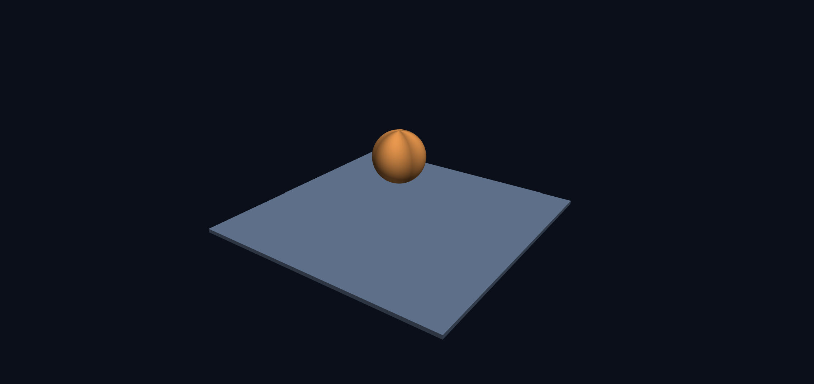
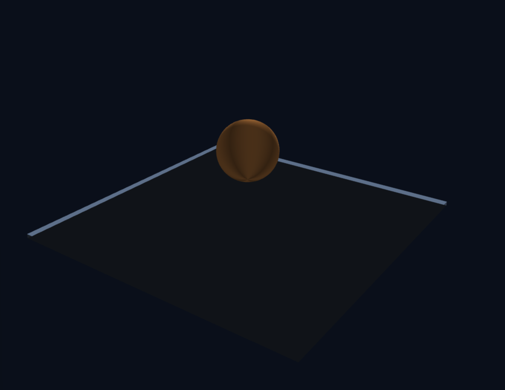
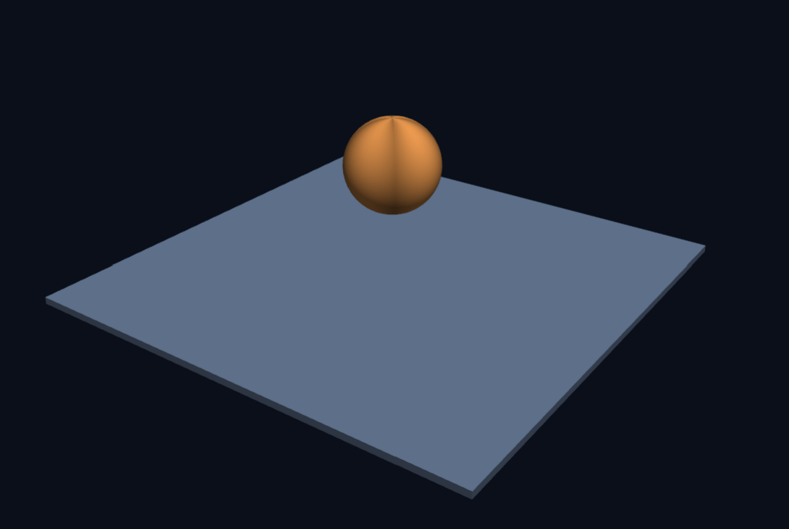
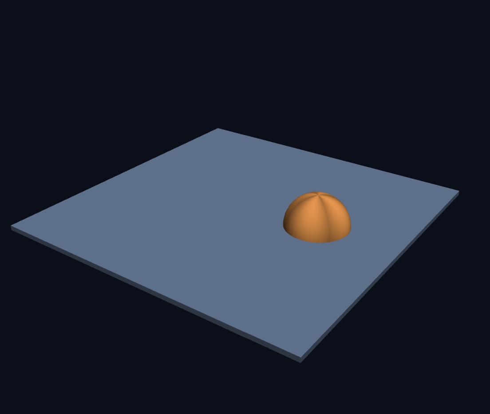
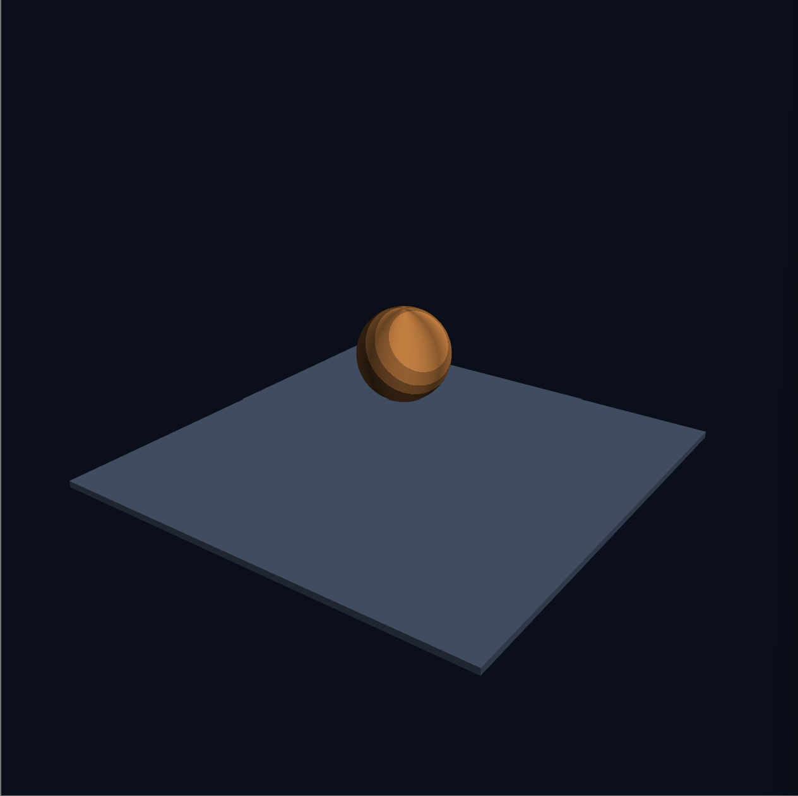
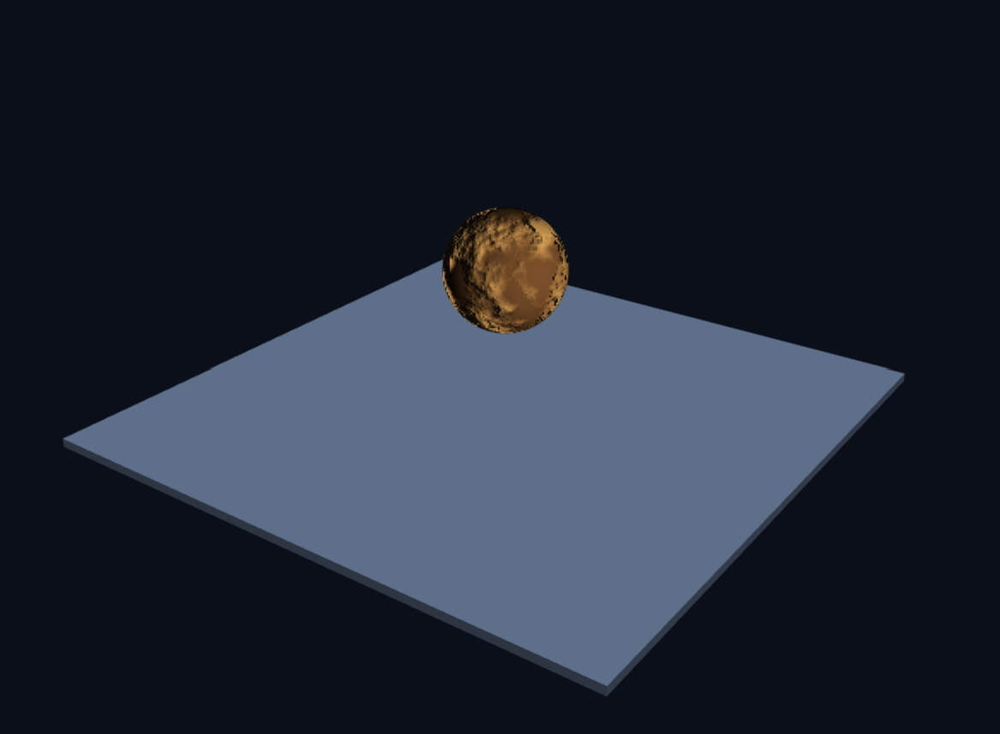
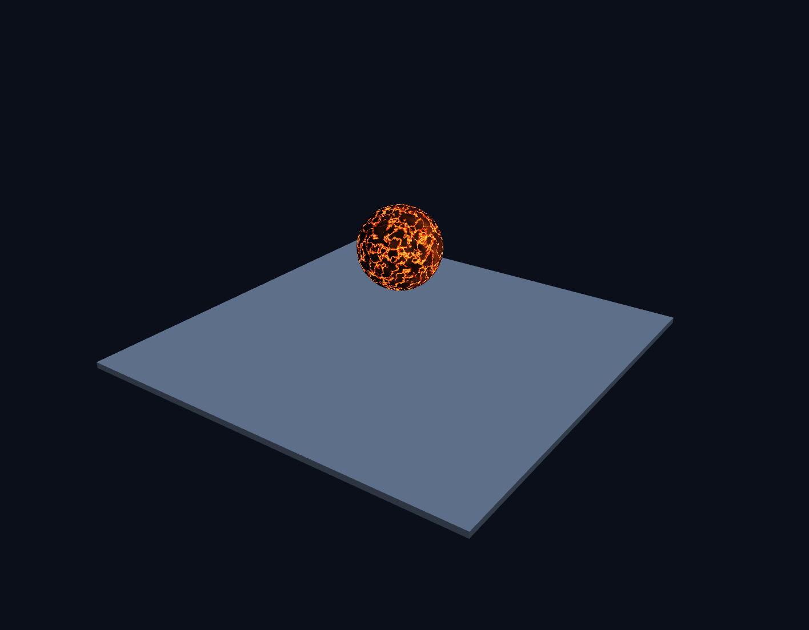

# 3주차 — 떠 있는 공에서 살아 있는 행성까지

- 이름: 김규완
- 저장소: https://github.com/kyuwan-kim/cg-2026-solar

- 실행: [Task 1](task1.html) · [Task 2](task2.html)

## Task 1 — 따라 하며 코드 구조 익히기

### 코드의 각 여섯 구역이 하는 역할
**1. 메시 데이터**

바닥과 공의 정점 위치, 법선 벡터, 색상, 그리고 삼각형 인덱스 데이터를 생성합니다.

**2. 버텍스 셰이더**

각 정점을 3차원 공간에서 2D 화면 좌표로 변환하고 색상과 법선을 다음 단계로 넘깁니다.

**3. 프래그먼트 셰이더**

빛의 방향과 법선을 계산해 픽셀 단위로 입체감 있는 명암과 최종 색상을 칠합니다.

**4. WebGL 준비 및 행렬 도구**

WebGL2 환경을 초기화하고, 셰이더를 컴파일하며, 3차원 변환을 위한 행렬 연산 도구를 정의합니다.

**5. 버퍼 생성 및 GPU 전송**

메시 데이터를 GPU 메모리로 업로드하고 렌더링에 사용할 VAO를 구성합니다.

**6. 매 프레임 렌더링 루프**

 매 프레임 화면을 지우고, 카메라와 애니메이션을 계산하여 바닥과 공을 화면에 그려냅니다.


### 코드를 따라하여 먼든 최종 결과
바닥이 깔린 3차원 공간에 공 하나가 공중에 떠서 천천히 도는 장면. 높은 곳에서 대각선으로 내려다보는 시점입니다.
- task1 결과 캡쳐


### gl.enable(gl.DEPTH_TEST)의 역할
```json
gl.enable(gl.DEPTH_TEST)
```
해당 코드는 깊이를 판단하여 가려지는 부분을 숨겨주는 코드로, 비활성화시 뒤에있어야 할 물체가 앞에 그려진 물체를 뚫고 나와 오류가 발생할 수 있습니다.
활성화 시 가까운 물체만 그리고 먼 물제는 가려지도록 합니다.

- 비활성화 시 화면



### 6단계의 순서를 바꾸기
```json
const model = M4.multiply(M4.rotateY(time * 0.8), M4.translate(1.9, 0, 0));
```

순서를 바꿀 시 자전하는 구가 공전을 하게 됩니다. 행렬은 뒤에서부터 적용되기 때문에 위치를 이동 시킨 뒤 회전시키면 구를 이동 시킨 후의 전체가 회전하기 때문에 자전하게 됩니다.

- task1 순서 수정 전

- task1 순서 수정 후


### 8단계의 실습 셰이더로 바꿔 보기
셰이더 실습실의 계단식 음영을 반영한 프레그먼트 셰이더 코드와 캡쳐화면입니다.
```json
const FS_SOURCE = `#version 300 es
precision highp float;                // 실수 정밀도 선언 — 여기서는 필수입니다

in vec3 vColor;                       // 버텍스 셰이더가 보낸 값이 "보간되어" 들어온다
in vec3 vNormal;

uniform float uTime;

out vec4 fragColor;                   // 이 픽셀의 최종 색

void main() {
  vec3 N = normalize(vNormal);
  vec3 L = normalize(vec3(cos(uTime), 0.8, sin(uTime)));

  float d = max(dot(N, L), 0.0);
  d = floor(d * 4.0) / 4.0;           // 4 단계로 끊는다

  fragColor = vec4(vColor * (0.2 + 0.8 * d), 1.0);
}
```

- task1셰이더 변환



## Task 2 - 프래그먼트 셰이더로 창의적 결과 만들기 (사막행성)
### 의도 — 무엇을 만들고 싶었는가

**어떤 행성을 만들려고 했습니까?**

모래 폭풍과 메마른 대지가 펼쳐진 황량하고 거친 사막 행성을 만들고자 했습니다.

**왜 그렇게 정했습니까? 보는 사람이 무엇을 느끼길 바랐습니까?**

황토색과 모래색의 자연스러운 색감 변화를 통해 외계 행성의 신비롭고 고요한 생태를 시각적으로 느끼길 바랐습니다.

**예시와 무엇을 다르게 하려 했습니까?**

단순한 단색 공에 셰이더 기반의 다중 노이즈(fbm)와 범프 맵핑을 결합해 실제 지형 같은 굴곡과 입체감을 주려 했습니다.

### 방법 — 어떻게 만들었는가
**그 모습을 내려면 어떤 계산이 필요하다고 판단했습니까?**

입체적인 사막 지형의 표면 무늬와 요철을 표현하기 위해 다중 주파수 잡음 함수와 법선 벡터를 변형하는 계산이 필요하다고 판단했습니다.

**실제로 쓴 계산식과 그 식이 왜 그런 무늬가 되는지를 설명하세요.**

```json
onst FS_SOURCE = `#version 300 es
precision highp float;

in vec3 vColor;
in vec3 vNormal;      // 세계 기준 법선 — 빛 계산에 쓴다
in vec3 vSurf;        // 물체 기준 법선 — 무늬가 표면에 붙어 돌게 한다

uniform float uTime;
uniform float uDesert;                // 0이면 원래 버텍스 색 바닥, 1이면 사막 행성

out vec4 fragColor;

/* ── 잡음 만들기 ───────────────────────────────────────────────
   이미지 파일 없이 무늬를 만들려면 "규칙적이지 않아 보이는 숫자"가 필요합니다.
   아래는 좌표를 넣으면 언제나 같은 0~1 값을 돌려주는 가짜 난수입니다.        */
float hash31(vec3 p) {
  p = fract(p * 0.3183099 + vec3(0.71, 0.113, 0.419));
  p *= 17.0;
  return fract(p.x * p.y * p.z * (p.x + p.y + p.z));
}

// 격자 꼭짓점의 난수를 부드럽게 섞어 "덩어리진" 잡음을 만듭니다
float noise3(vec3 x) {
  vec3 i = floor(x), f = fract(x);
  f = f * f * (3.0 - 2.0 * f);                 // 부드럽게 (smoothstep 과 같은 곡선)
  return mix(mix(mix(hash31(i + vec3(0,0,0)), hash31(i + vec3(1,0,0)), f.x),
                 mix(hash31(i + vec3(0,1,0)), hash31(i + vec3(1,1,0)), f.x), f.y),
             mix(mix(hash31(i + vec3(0,0,1)), hash31(i + vec3(1,0,1)), f.x),
                 mix(hash31(i + vec3(0,1,1)), hash31(i + vec3(1,1,1)), f.x), f.y), f.z);
}

// 크기가 다른 잡음을 여러 겹 더합니다 → 큰 덩어리와 잔 무늬가 함께 생깁니다
float fbm(vec3 p) {
  float v = 0.0, a = 0.5;
  for (int i = 0; i < 5; i++) { v += a * noise3(p); p *= 2.02; a *= 0.5; }
  return v;
}

void main() {
  vec3 N = normalize(vNormal);
  vec3 L = normalize(vec3(0.9, 0.25, 0.35));

  if (uDesert < 0.5) {
    // 바닥은 task1과 같은 광원과 버텍스 색을 사용해 원래 색을 유지한다.
    vec3 floorLight = normalize(vec3(0.45, 0.8, 0.35));
    float diff = max(dot(N, floorLight), 0.0);
    fragColor = vec4(vColor * (0.3 + 0.7 * diff), 1.0);
    return;
  }

  vec3 S = normalize(vSurf);
  // 넓은 잡음 무늬를 부드럽게 나눠 밝고 어두운 사막 지형을 만든다.
  float pattern = fbm(S * 1.7);
  float mare = smoothstep(0.37, 0.65, pattern); // 넓은 경계 구간으로 색 전환을 부드럽게
  float height = (mare - 0.5) * 0.6;             // 밝은 무늬가 높아지도록 높이를 설정
  // 높이 변화로 법선을 반전 보정해 밝은 부분은 솟고 어두운 부분은 낮아 보이게 한다.
  vec3 bumped = normalize(N - vec3(dFdx(height), dFdy(height), 0.0) * 12.0);
  float diff = max(dot(bumped, L), 0.0);
  // 어두운 황토색과 밝은 모래색 사이를 무늬 값에 따라 섞는다.
  vec3 albedo = mix(vec3(0.48, 0.31, 0.16), vec3(0.96, 0.72, 0.38), mare);

  vec3 color = albedo * (0.06 + 0.94 * diff);
  fragColor = vec4(color, 1.0);
}
`;
```

크기가 다른 여러 노이즈 겹을 더해 거대한 사막 덩어리와 미세한 모래 결 무늬를 동시에 만들었습니다.

법선 범프 변형 (bumped): 높낮이 값(height)의 미분값(dFdx, dFdy)을 이용해 표면 법선을 틀어주어 밝은 부분은 솟고 어두운 부분은 파인 듯한 입체감을 냈습니다.


- task2 결과 캡쳐


## Task 3 - 프래그먼트 셰이더로 창의적 결과 만들기 (용암행성)
### 의도 — 무엇을 만들고 싶었는가

**어떤 행성을 만들려고 했습니까?**

어두운 지각 사이로 붉고 주황색의 용암이 흐르고, 중심부가 노랗게 빛나는 용암 행성을 만들고자 했습니다.

**왜 그렇게 정했습니까? 보는 사람이 무엇을 느끼길 바랐습니까?**

뜨겁고 위험하면서도 역동적인 분위기를 전달하고 싶었습니다. 어두운 표면과 밝게 빛나는 용암의 대비를 통해 행성 내부의 강렬한 열에너지를 느끼게 하고자 했습니다.

**예시와 무엇을 다르게 하려 했습니까?**

단순히 행성의 색상만 바꾸는 것이 아니라, 노이즈를 활용해 불규칙한 용암 균열을 만들고 시간에 따라 무늬가 흐르는 효과를 적용해 살아 움직이는 듯한 행성을 표현하고자 했습니다.

### 방법 — 어떻게 만들었는가
**그 모습을 내려면 어떤 계산이 필요하다고 판단했습니까?**

노이즈 값에 따라 용암과 어두운 지각을 구분했습니다. 또한 광원과 법선 벡터의 내적을 이용해 명암을 계산하고, 시간값을 좌표에 더해 무늬가 흐르는 효과를 구현했습니다.

**실제로 쓴 계산식과 그 식이 왜 그런 무늬가 되는지를 설명하세요.**

```json
const FS_SOURCE = `#version 300 es
precision highp float;

in vec3 vColor;
in vec3 vNormal;      // 세계 기준 법선 — 빛 계산에 쓴다
in vec3 vSurf;        // 물체 기준 법선 — 무늬가 표면에 붙어 돌게 한다

uniform float uTime;
uniform float uDesert;                // 0이면 바닥, 1이면 행성

out vec4 fragColor;

/* ── 잡음 만들기 ───────────────────────────────────────────────
   이미지 파일 없이 무늬를 만들려면 "규칙적이지 않아 보이는 숫자"가 필요합니다.
   아래는 좌표를 넣으면 언제나 같은 0~1 값을 돌려주는 가짜 난수입니다.        */
float hash31(vec3 p) {
  p = fract(p * 0.3183099 + vec3(0.71, 0.113, 0.419));
  p *= 17.0;
  return fract(p.x * p.y * p.z * (p.x + p.y + p.z));
}

// 격자 꼭짓점의 난수를 부드럽게 섞어 "덩어리진" 잡음을 만듭니다
float noise3(vec3 x) {
  vec3 i = floor(x), f = fract(x);
  f = f * f * (3.0 - 2.0 * f);                 // 부드럽게 (smoothstep 과 같은 곡선)
  return mix(mix(mix(hash31(i + vec3(0,0,0)), hash31(i + vec3(1,0,0)), f.x),
                 mix(hash31(i + vec3(0,1,0)), hash31(i + vec3(1,1,0)), f.x), f.y),
             mix(mix(hash31(i + vec3(0,0,1)), hash31(i + vec3(1,0,1)), f.x),
                 mix(hash31(i + vec3(0,1,1)), hash31(i + vec3(1,1,1)), f.x), f.y), f.z);
}

// 크기가 다른 잡음을 여러 겹 더합니다 → 큰 덩어리와 잔 무늬가 함께 생깁니다
float fbm(vec3 p) {
  float v = 0.0, a = 0.5;
  for (int i = 0; i < 5; i++) { v += a * noise3(p); p *= 2.02; a *= 0.5; }
  return v;
}

void main() {
  vec3 N = normalize(vNormal);
  vec3 L = normalize(vec3(0.9, 0.25, 0.35));

  if (uDesert < 0.5) {
    // 바닥은 task1과 같은 광원과 버텍스 색을 사용해 원래 색을 유지한다.
    vec3 floorLight = normalize(vec3(0.45, 0.8, 0.35));
    float diff = max(dot(N, floorLight), 0.0);
    fragColor = vec4(vColor * (0.3 + 0.7 * diff), 1.0);
    return;
  }

  vec3 S = normalize(vSurf);
  float diff = max(dot(N, L), 0.0);

  // 흐르는 좌표와 저주파 왜곡으로 갈라진 용암 균열을 만든다.
  vec3 drift = vec3(uTime * 0.10, -uTime * 0.07, uTime * 0.05);
  float warp = fbm(S * 2.8 + drift);
  float flow = fbm(S * 6.0 + drift * 1.7 + (warp - 0.5) * 1.4);
  float cracks = 1.0 - smoothstep(0.018, 0.075, abs(flow - 0.48));
  float hotCore = 1.0 - smoothstep(0.0, 0.035, abs(flow - 0.48));

  // 용암 사이에는 어두운 갈색의 식은 지각을 남긴다.
  float crustVariation = smoothstep(0.28, 0.72, fbm(S * 4.0 + drift * 0.6));
  vec3 crust = mix(vec3(0.075, 0.035, 0.022),
                   vec3(0.30, 0.13, 0.055), crustVariation);
  vec3 lava = mix(vec3(0.95, 0.12, 0.015),
                  vec3(1.0, 0.78, 0.20), hotCore);

  vec3 color = crust * (0.10 + 0.90 * diff);
  color += lava * cracks;
  float rim = pow(1.0 - abs(dot(N, normalize(vec3(0.0, 0.1, 1.0)))), 3.0);
  color += vec3(0.28, 0.07, 0.015) * rim * diff;
  fragColor = vec4(color, 1.0);
}
`;
```

왜곡된 좌표로 노이즈를 계산해 용암이 갈라지고 흐르는 듯한 불규칙한 패턴을 만듭니다.

노이즈 값이 0.48에 가까운 부분을 강조해 용암 균열의 형태를 만듭니다.

균열의 중심부를 더욱 좁게 강조해 노란색으로 뜨겁게 빛나는 부분을 표현합니다.

표면의 법선 벡터와 광원 방향의 내적을 계산해 빛을 받는 정도를 구하고, 행성의 입체감을 표현합니다.


- task3 결과 캡쳐

