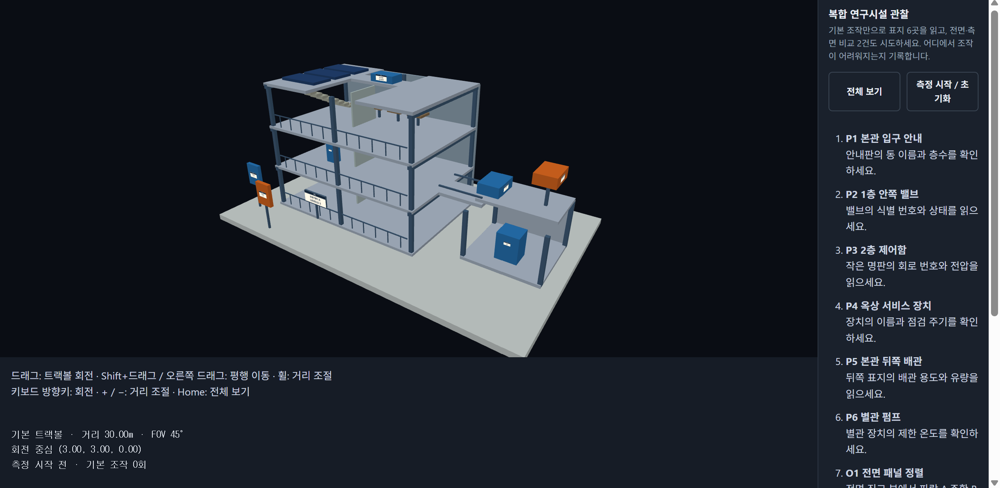
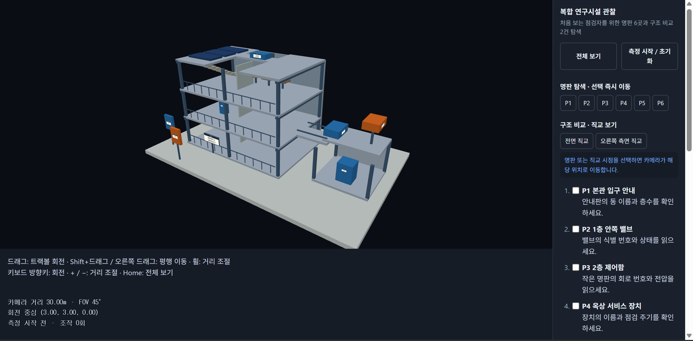
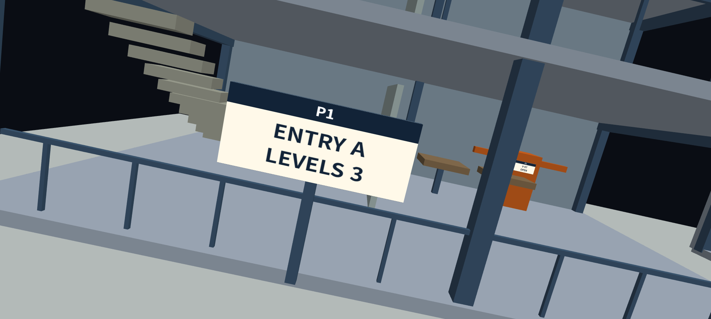
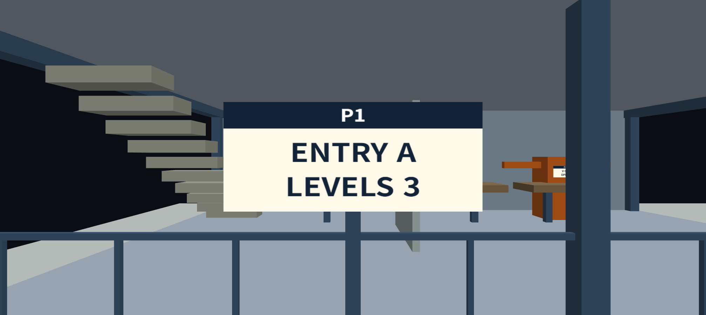
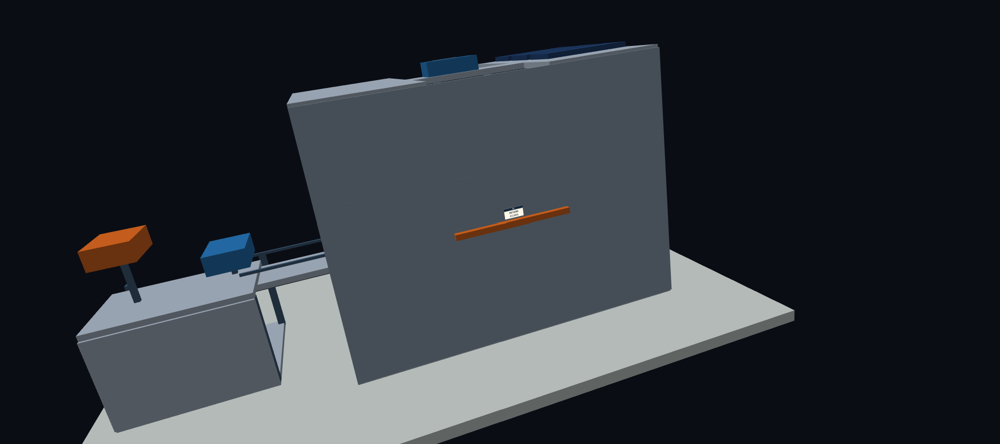
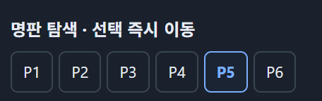
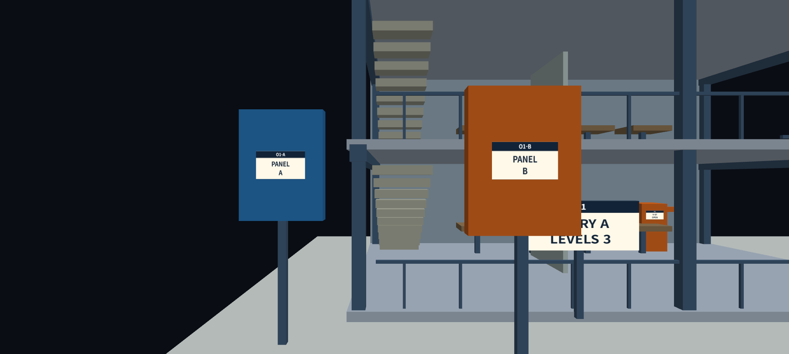
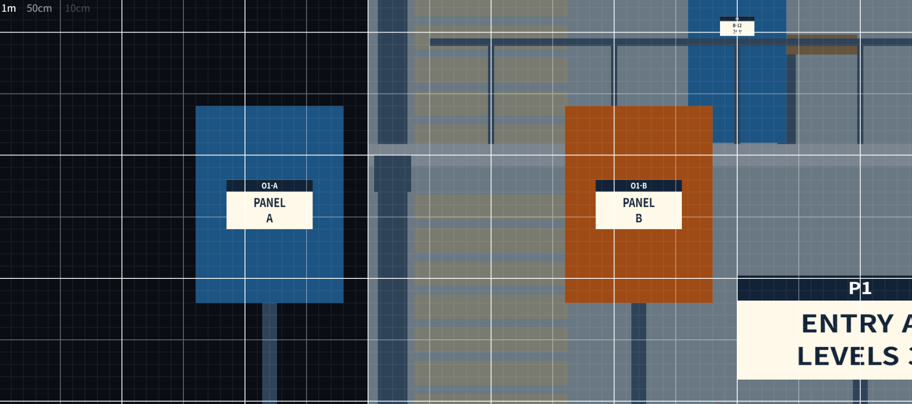
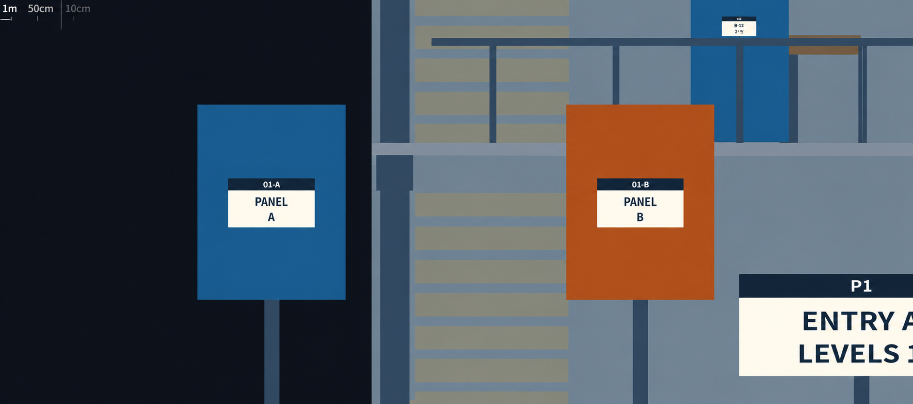

# 4주차 — 중요한 정보를 놓치지 않는 3D 관찰 인터페이스

- 이름: 김규완
- 저장소: https://github.com/kyuwan-kim/cg-2026-solar
- 실행: [baseline](baseline/index.html) · [improved](improved/index.html)

## 두 버전의 실행 주소와 조작법
### baseline 조작법
    드래그: 트랙볼 회전
    Shift+드래그 / 오른쪽 드래그: 평행 이동
    휠: 거리 조절
    키보드 방향키: 회전 
    + / −: 거리 조절
    Home: 전체 보기
- baseline 캡쳐

- 공유 링크: [baseline](http://127.0.0.1:5500/week4/baseline/index.html)

### improved 조작법
    드래그: 트랙볼 회전
    Shift+드래그 / 오른쪽 드래그: 평행 이동
    휠: 거리 조절
    키보드 방향키: 회전 
    + / −: 거리 조절
    Home: 전체 보기
    P1~P6: 해당 명판앞으로 카메라 이동
    전면 직교, 오른쪽 측면 직교: 직교뷰로 O1, O2 앞으로 이동
- improved 캡쳐

- 공유 링크: [improved](http://127.0.0.1:5500/week4/improved/index.html)

## 기본 버전의 지점별 관찰 결과와 불편 3개 이상
### 지점별 관찰 결과
| 지점 | 성공/실패 | 걸린 시간 | 불필요한 조작·되돌아가기 | 어려웠던 이유 |
| --- | --- | --- | --- | --- |
| P1~P6 | 성공 | 73초 | 353 | 조작이 익숙하지 않아 화면을 조작하여 원하는 패널을 찾아 위치를 잡기 어려웠음 |
| O1~O2 | 실패 | . | . | 카메라 시점에서 투시가 있고, 크기를 잴 수 있는 요소가 부족하여 두 물체간의 크기를 비교하기 어려웠음 |

### 관찰중 불편
- 화면의 각도가 계속 틀어져 어지러움 유발
- 원하는 명판이 어디 있는지 몰라 해매게 됨
- 투시가 적용되어 물체간의 크기를 비교하기 어려움

## 사용자·관찰 목표, 대안 2개 이상의 스케치와 비교, 선택·조합한 이유
### 사용자·관찰 목표
- **사용자**: 시설을 처음 보는 점검자
- **관찰 목표**: 여섯 장치의 정보와 두 구조 비교를 빠짐없이 확인
### 대안 2가지
1.  **p1~p6, O1~O2 버튼 누를시 이동**

    **장점**: 복잡한 조작 없이 패널의 내용 확인 가능

    **단점**: 패널이 건물의 어디에 위치하는지 확인 불가

2.  **패널을 찾아 클릭시 카메라 자동 이동**

    **장점**: 직접 패널을 찾아가기에 건물의 어디에 위치하는지 사용자가 직관적으로 확인 가능

    **단점**: 원하는 패널을 바로바로 찾아가기 어려움

### 최종 선택·조합한 이유
**버튼**을 누르면 자동으로 패널을 찾아가되, 카메라가 패널을 찾아가기 전 **건물의 전체를 한번 비춘 후**  패널을 찾아가도록하여 패널이 건물의 어디에 위치하는지 알 수 있도록 함, 또한, O1, O2의 경우 크기를 비교하기 쉽도록 **직교투영**을 활용하고, **그리드**로 크기를 비교하기 쉽게 함

## 실제 구현한 카메라·투영·입력 방식의 설명과 대표 코드

### 카메라 위치와 방향 계산 코드
```json
const verticalHalf = Math.tan(controls.state.fov * Math.PI / 360);
const horizontalHalf = verticalHalf * aspect;
const distance = Math.max(
  sign.size[0] / (2 * horizontalHalf * .42),
  sign.size[1] / (2 * verticalHalf * .34)
);
const normal = [Math.sin(sign.yaw), 0, Math.cos(sign.yaw)];
const eye = sign.position.map((value, i) => value + normal[i] * distance);
return { eye, target: [...sign.position], up: [0, 1, 0], fov: controls.state.fov };
```
표지판(Sign)의 크기와 카메라 시야각(FOV)을 고려해 화면에 표지판이 적절한 크기로 보이도록 카메라의 위치와 방향을 자동으로 계산하는 코드
### 직교투영 코드
```json
if (camera.orthographic) {
  M.ortho(projection, -half * w / h, half * w / h, -half, half,
    camera.near || .02, camera.far || 180);
} else {
  M.perspective(projection, (camera.fov || controls.state.fov) * Math.PI / 180,
    w / h, camera.near || .02, camera.far || 180);
}
```
카메라의 투영 방식(직교 투영 또는 원근 투영)에 따라 화면에 보이는 영역과 깊이 범위를 계산해 투영 행렬(projection matrix)을 설정하는 코드

## 같은 8건에 대한 개선 전후 비교, 측정 한계, 추가 수정 전후의 기록
### 개선 전후 비교
| 비교 항목	| 기본 버전 | 개선 버전	| 해석 |
| --- | --- | --- | --- |
| 관찰 완료 수 | 6/8 | 8/8 | O1, O2의 비교를 추가로 성공 |
| 전체 관찰 시간 | 73초 | 47초 | 더 빠르게 읽기와 위치 확인 |
| 조작 부담 | 353횟수 | 8횟수 | 최소한의 움직임으로 조작 완료 |

### 대표 불편, 해결 3가지
1. **불편**: 화면 수평을 맞추기 어려워 어지러움 유발

**해결**: 수평을 유지한체 자동으로 카메라 이동시켜 수평 맞출 필요 X


2. **불편**: 패널의 위치 찾기 어려움

**해결**: 버튼만 누를시 원하는 패널 찾아가기 가능


3. **불편**: 직교 시점이 없어 거리가 있는 물체 크기 비교 곤란

**해결**: 직교 시점 추가


### 측정 한계
새로운 패널이 추가되거나 패널의 위치가 바뀔 시 새로 카메라의 시점을 바꿔야함

### 추가 수정 전후의 기록
처음엔 O1~O2를 확인할때 **직교뷰**를 사용했음에도 불구하고, 두 물체를 비교하기 모호했으나, **그리드**를 추가하여 더욱 비교하기 쉽도록 함



## 중요한 Copilot 제안과 본인의 판단 또는 직접 구현한 경우 검토한 대안
Copilot은 명판 선택 시 카메라 이동과 직교 격자 구현을 도왔음. 별도 이동 버튼 없이 선택 즉시 이동하고, 명판 크기를 일정하게 보이며 P5 이동 중 건물 전체를 회전해 보여주는 방식이 점검에 더 적합하다고 판단해 적용