# 5주차 — 태양 하나로 만드는 낮과 밤

- 이름: 김규완
- 저장소: https://github.com/kyuwan-kim/cg-2026-solar

- 실행: [Task 1](task1.html) · [Task 2](task2.html)

## Task 1 — 납작한 원을 구로 만들기 — 단계별로 조명 넣기

### 1단계-확산 반사
```json
  vec3 diffuse = max(dot(N, L), 0.0) * uBaseColor * uLightColor;
  fragColor = vec4(diffuse, 1.0);
```
- 1단계 결과 캡쳐
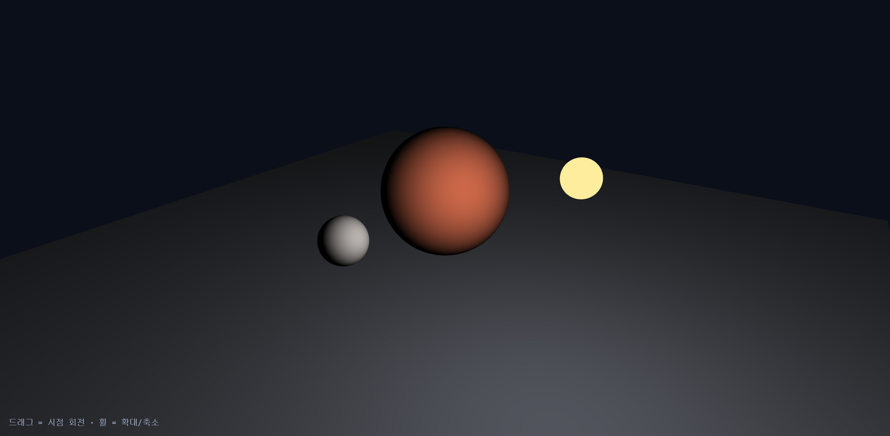

**단계 1 의 max 제거 예측과 실제 결과**

**예측**: max는 0보다 작은 음수는 0으로 표현하여 음수를 나오지 않게 하는 역할을 함.
없앨경우 빛을 등진 표면이 음수가 되어 빛을 빼는 효과를 냄. 즉,  밝아야할 면과 겹칠 경우 그 면의 빛을 빼서 **밝아야할 면이 어둡게 보이게 될것**.


**결과**: 예측과 같이 **밝아야할 면이 어둡게 보임**
- 1단계 max 제거 결과 캡쳐
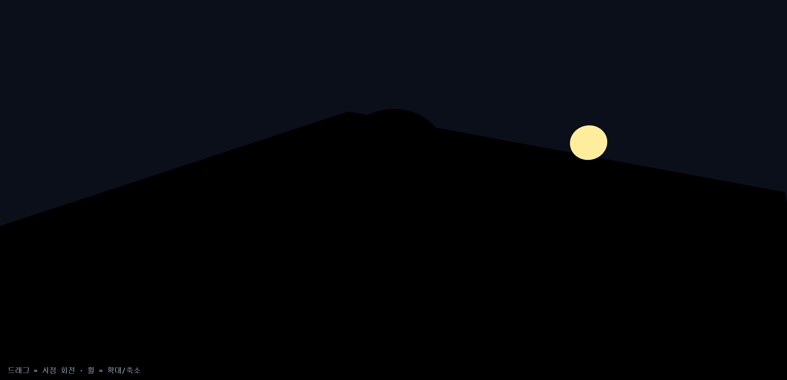

### 2단계-환경광
```json
  vec3 ambient = 0.08 * uBaseColor;
  fragColor = vec4(ambient + diffuse, 1.0);
```
- 2단계 결과 캡쳐
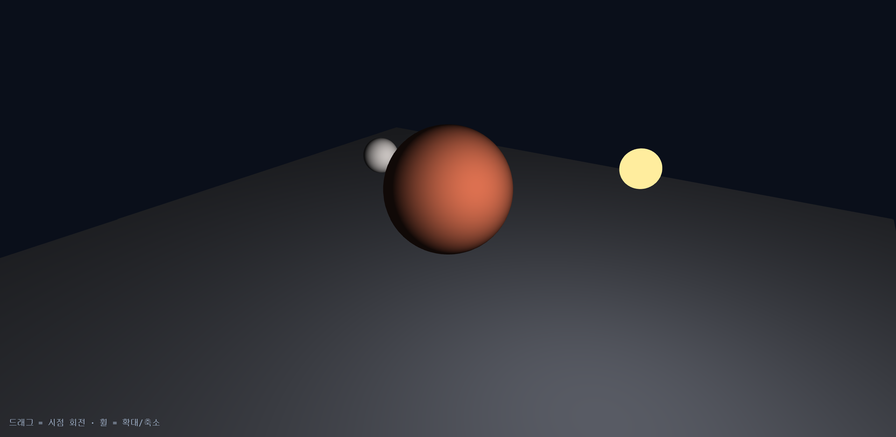

### 3단계-정반사
```json
  vec3 R = reflect(-L, N);
  vec3 specular = pow(max(dot(R, V), 0.0), uShininess) * uLightColor * 0.5;
  fragColor = vec4(ambient + diffuse + specular, 1.0);
```
- 3단계 결과 캡쳐
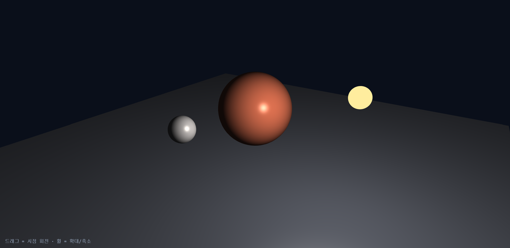

### 4단계-거리감쇠
```json
  float d   = length(uLightPos - vWorldPos);
  float att = 1.0 / (1.0 + 0.02 * d * d);
  fragColor = vec4(ambient + (diffuse + specular) * att, 1.0);
```
- 4단계 결과 캡쳐
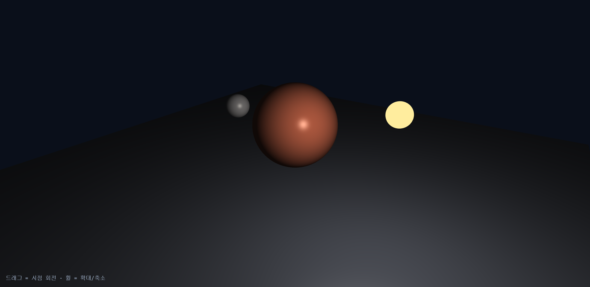

### 5단계-법선행렬
```json
  // 바꾸기 전
  vNormal = mat3(uModel) * aNormal;
  // 바꾼 뒤
  vNormal = uNormalMat * aNormal;
```
- 5단계 결과 캡쳐
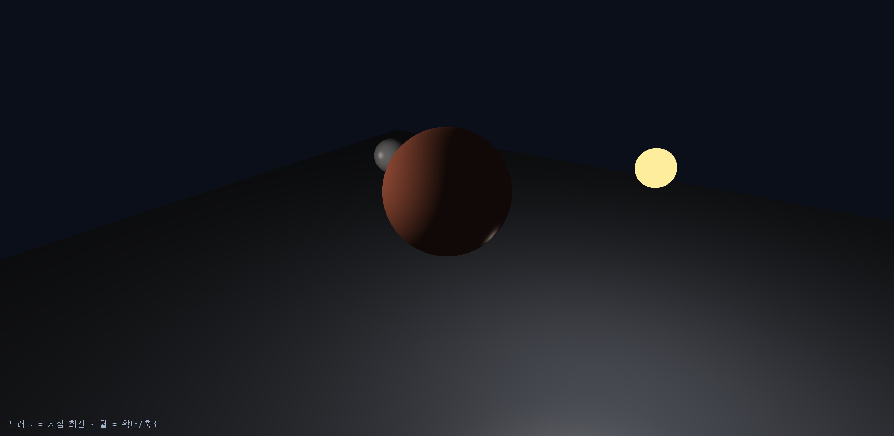

**비균등 스케일 비교 캡처 mat3(uModel) 과 uNormalMat**
```json
  m = Mat4.multiply(m, Mat4.scale(1.3, 1.3, 1.3));     // 원래
  m = Mat4.multiply(m, Mat4.scale(0.7, 2.2, 0.7));     // 길게 늘인다
```
- mat3(uModel)
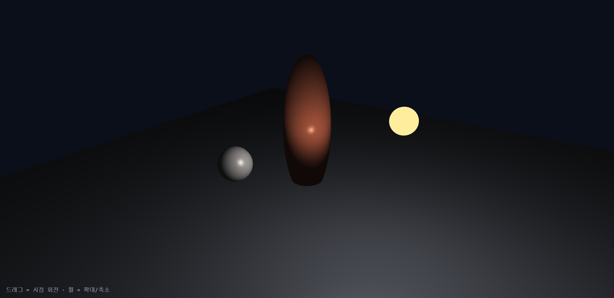
- uNormalMat
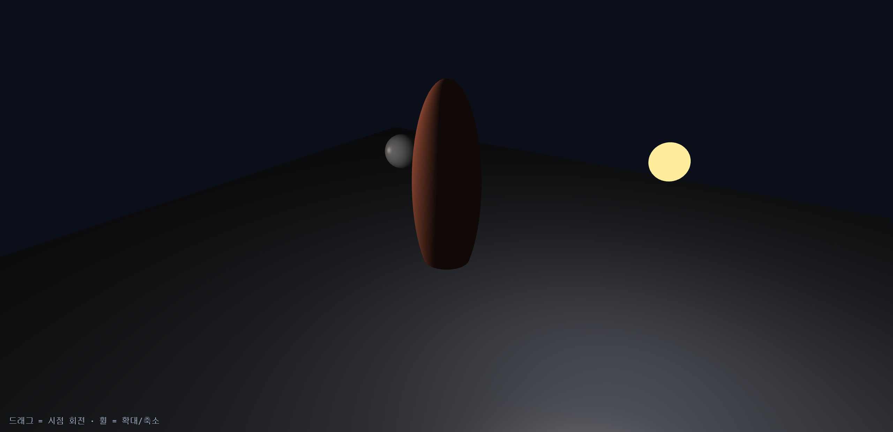

### 6단계-광원종류 바꾸기
```json
  // point
  vec3 L = normalize(uLightPos - vWorldPos);
  // directional — 방향 하나로 고정
  vec3 L = normalize(vec3(0.4, 0.8, 0.5));
```
Point light는 광원 위치에 따라 가까운 쪽이 더 밝고, 물체의 위치가 달라지면 빛이 비치는 방향과 밝기도 함께 달라져 전구처럼 보입니다. 

Directional light는 모든 곳에서 같은 방향으로 빛이 들어오고 거리에 따른 밝기 차이가 거의 없어, 그림자와 밝은 면의 방향은 유지되면서 장면 전체가 고르게 비춰지는 태양빛처럼 보입니다.
- 6단계 결과 캡쳐
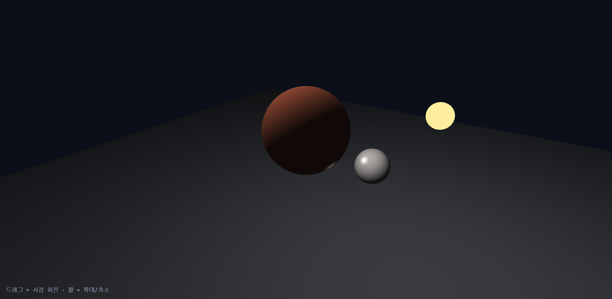

- spot추가 결과 챕쳐
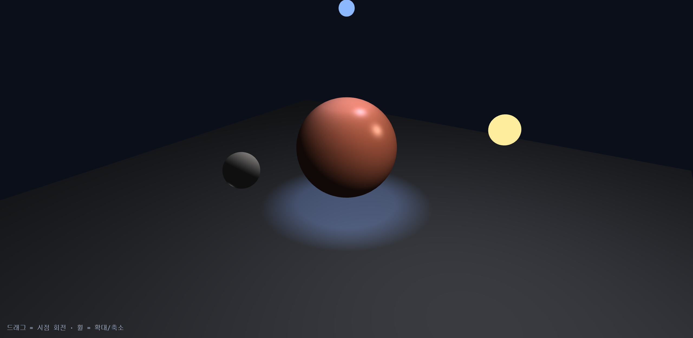

## Task 2 — 빛으로 분위기 만들기

### 의도 — 어떤 장면·분위기를 만들려 했는지
황량한 행성의 밤을 배경으로, 멀리 떠 있는 주황색 광원과 행성을 비추는 푸른 탐사선을 배치했습니다. 따뜻한 주황빛과 차가운 푸른빛이 대비되어 SF 영화 같은 분위기를 만들고, 두 광원을 끄고 켜며 장면의 차이를 확인할 수 있도록 했습니다.

### 방법 — 광원을 몇 개, 어떤 종류로, 어디에, 무슨 색으로 놓았는지. 재질은 어떻게 나눴는지
점광원과 스포트라이트, 총 두 개의 광원을 사용했습니다.
- **주황색 점광원**: 장면에서 먼 위치 `(-16, 약 4.2, -9)`에 두고 거리 감쇠를 적용했습니다. 자체발광 구체로 표시했으며, 키 `1`로 광원과 구체를 함께 끌 수 있습니다.
- **푸른 스포트라이트**: 하늘색 탐사선에 부착했습니다. 탐사선은 큰 행성 중심에서 반경 `6.4`를 초당 `0.98`라디안의 속도로 공전하며, 스포트라이트는 궤도 안쪽을 향해 중심 행성을 비춥니다. 키 `2`로 탐사선과 스포트라이트를 함께 끌 수 있습니다.
- **재질**: 큰 행성은 높은 반짝임과 강한 정반사(`shininess 140`, `Ks 0.90`)로 매끄럽게, 작은 행성은 낮은 반짝임과 약한 정반사(`shininess 10`, `Ks 0.08`)로 거칠게 표현했습니다.

### 광원을 하나씩 끈 캡처 (각 광원이 무엇을 담당하는지 보이게)
**푸른 탐사선과 스포트라이트 끔 (키 2)** — 주황색 점광원이 바닥과 행성을 비춥니다.
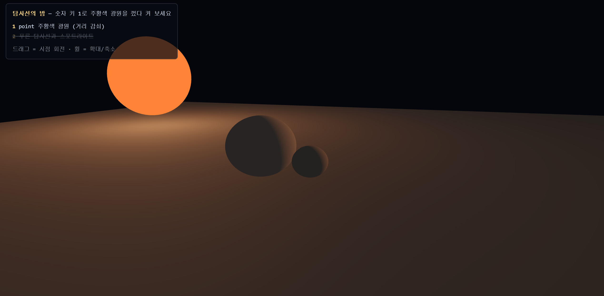

**주황색 점광원 끔 (키 1)** — 푸른 스포트라이트가 중심 행성을 비춥니다.
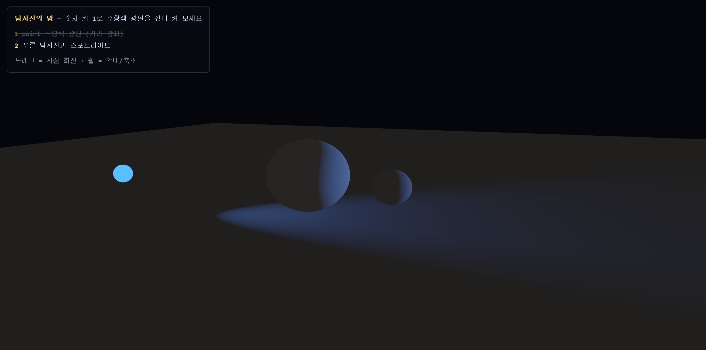

### 최종 캡처 1장 이상
두 광원을 모두 켠 최종 장면입니다.
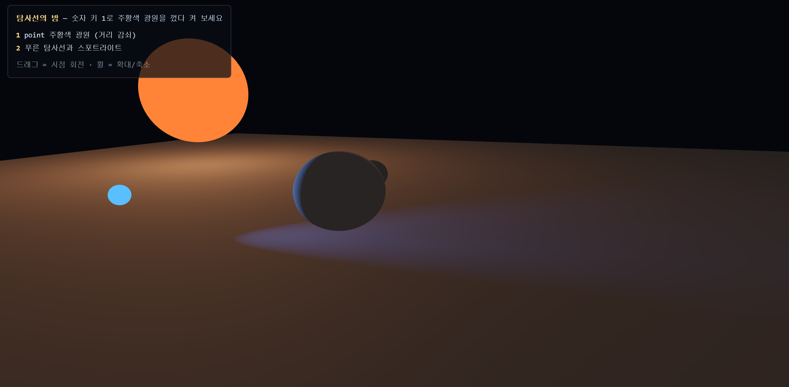

### AI 를 썼다면 무엇을 요청했고 무엇을 고쳤는지
AI에게 광원과 행성 배치, 공전, 탐사선의 스포트라이트를 수정해 달라고 요청했습니다. 주황색 광원의 크기와 높이, 행성의 개수와 재질을 조정했습니다. 탐사선의 색을 하늘색으로 바꾸고, 공전 속도를 기존의 70%로 낮췄으며, 스포트라이트 방향을 궤도 진행 방향에서 중심 행성 쪽으로 바꾸고 밝기를 높였습니다. 마지막으로 키 `1`과 `2`로 각 광원과 해당 구체·탐사선을 따로 켜고 끄도록 수정했습니다.